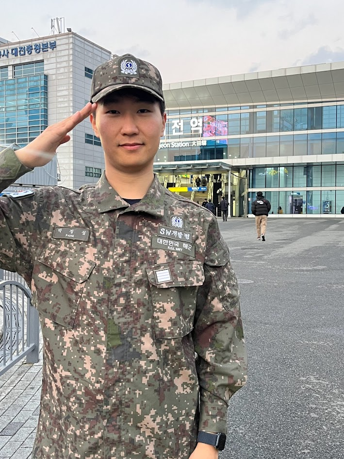
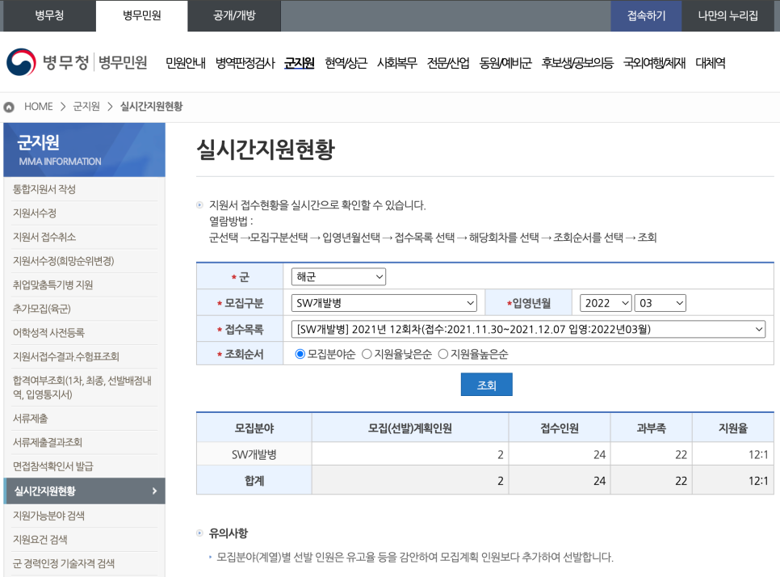
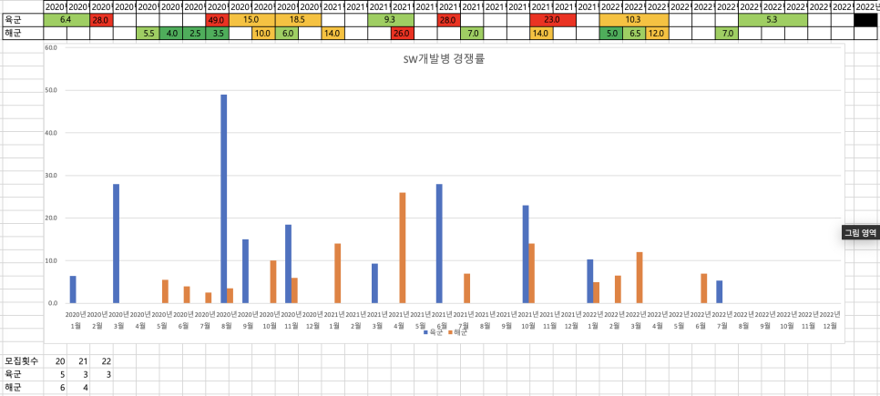
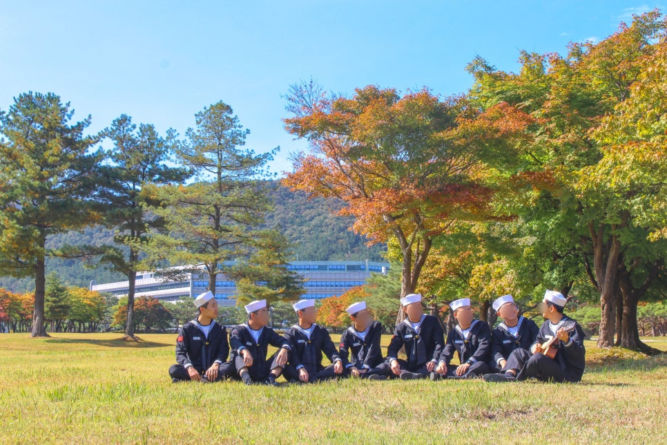
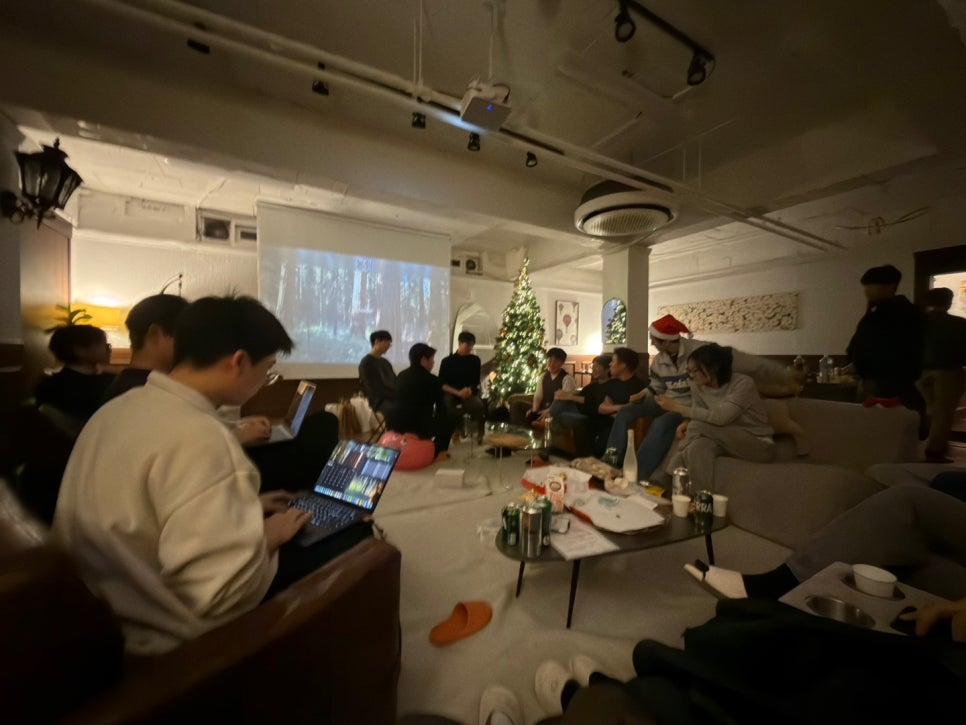
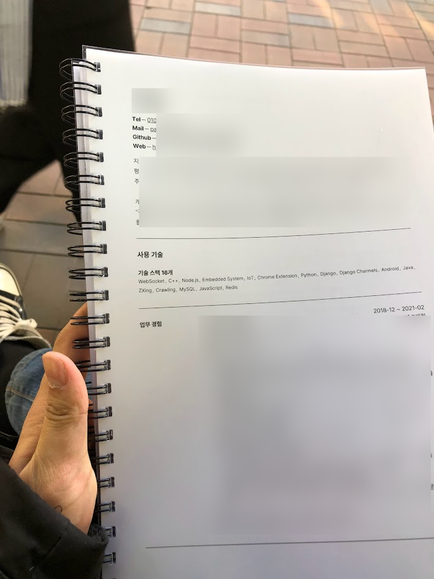
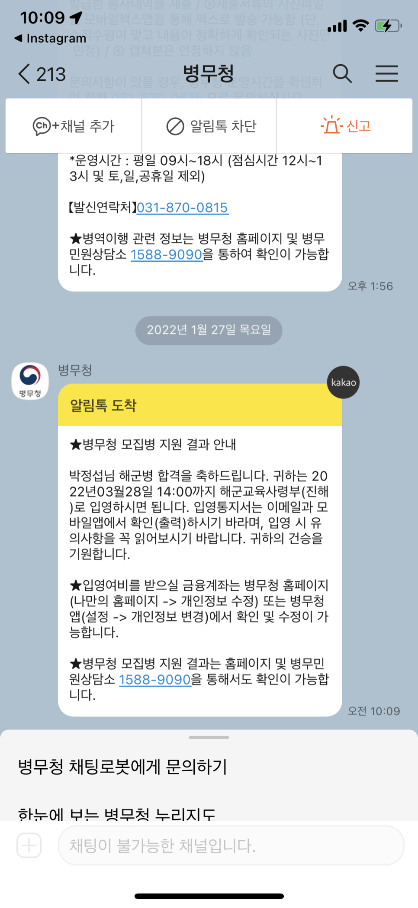
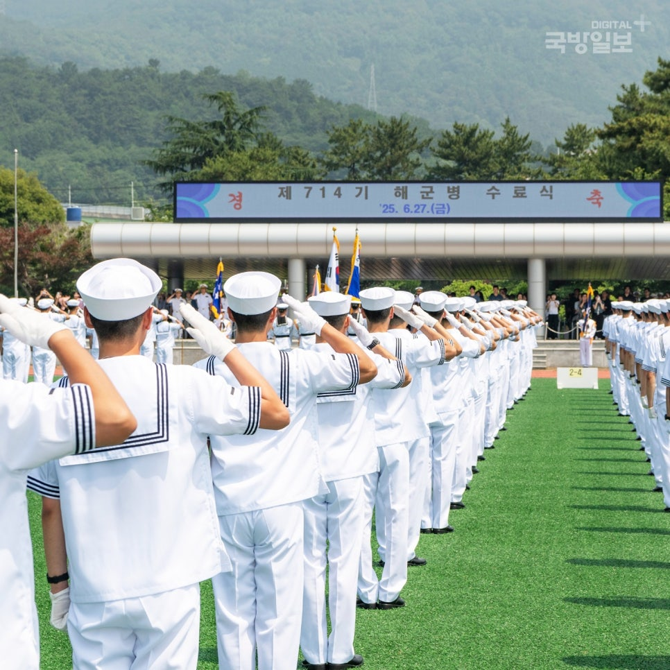

*전역하는 날. 대전역 앞에서 '대'를 가려 **'전역'** 글자만 남게 찍는 포즈가 군인들 사이에서 유행이다.*

> 1전 2기. 두 번 만에 붙었다.

첫 지원은 아쉽게 떨어졌고, 두 번째 지원에서 합격했다. 그렇게 해군 소프트웨어 개발병으로 입대하게 되었다.

이 글은 내가 해군 SW개발병을 선택한 이유, 3군 비교, 서류와 면접 준비, 그리고 재도전 과정까지를 정리한 기록이다.

## 왜 SW개발병이었나

대한민국은 휴전 국가이고, 그래서 징병제를 유지하고 있다. 한국 남자라면 군복무를 해야 한다. 나는 군복무를 단순히 의무로만 보지 않고, **나라를 지키기 위한 국가에 대한 봉사**라고 생각했다.

나는 평소 봉사를 할 때도 내가 가진 능력을 활용하는 **재능 봉사**를 꾸준히 해왔다. 고등학생 때부터는 소프트웨어 교육 봉사활동을 하며 내가 익힌 개발 지식을 다른 사람들에게 가르쳐 주기도 했다. 그래서 군대에서도 마찬가지로, 단순히 시간을 보내기보다는 **내 능력을 활용해서 국가에 기여할 수 있는 보직**을 찾고 싶었다.

내가 비교적 자신 있었던 분야는 두 가지였다. 어릴 때부터 꾸준히 해온 **소프트웨어 개발**, 그리고 일찍 면허를 따서 경험이 많았던 **운전**이었다. 그래서 처음에는 아래 두 보직을 놓고 고민했다.

- SW개발병
- 운전병

운전병도 꽤 매력적인 선택지였다. 특히 전역 이후 자동차 보험료 할인을 받을 수 있다는 점이 현실적으로 크게 다가왔다. 20대 초반에는 보험료가 꽤 비싸기 때문이다.

하지만 결국, 내 특기를 가장 잘 살릴 수 있는 보직을 선택하고 싶었다. 그래서 **소프트웨어 개발병**에 지원하기로 했다.

## 왜 해군 SW개발병인가

대한민국 군종은 육군, 해군, 공군, 해병대 네 가지다. 해병대는 해군 예하 군종이라 해병대에서 사용하는 소프트웨어도 해군 SW개발병이 함께 담당한다. 공개된 정보가 많지는 않지만, 군 내부에서 사용되는 웹·앱 등의 소프트웨어 개발이 주 업무다.

> 💡 공식 모집 안내는 [병무청 해군 SW개발병 페이지](https://www.mma.go.kr/contents.do?mc=mma0003468)에서 확인할 수 있다. 자격 요건, 서류 배점, 지원 일정이 모두 정리되어 있으니 지원 전 반드시 확인하자.

우선 각 군종별 복무기간을 정리하면 다음과 같다.

| 군종 | 복무기간 | 육군 대비 |
|---|---|---|
| 육군 | 18개월 | - |
| 해군 | 20개월 | +2개월 |
| 공군 | 21개월 | +3개월 |
| 해병대 | 18개월 | 동일 |

### 공군은 후보에서 제외

공군은 현재 IT개발관리병으로 별도 모집하지만, 내가 준비할 당시에는 공군 전산병으로 입대한 뒤 훈련소 성적에 따라 SW개발병으로 선발되는 방식이었다. 나는 SW개발병으로 복무하고 싶었지 운에 맡기고 싶지 않았다. 육군과 해군은 떨어지면 다시 지원하면 되지만, 공군은 일단 전산병으로 복무를 시작해야 했기 때문에 후보에서 제외했다.

### 육군 vs 해군 — 경쟁률 데이터로 판단

남은 후보는 육군과 해군이었다. 병무청 홈페이지에서 최근 3년간의 경쟁률을 조회할 수 있어 직접 조사해봤다.

조회한 데이터를 기수별로 정리해서 육군·해군 SW개발병 경쟁률을 한눈에 비교해봤다.

SW개발병은 모집 인원 자체가 적어 경쟁률이 들쭉날쭉했지만, 전반적으로 **육군이 해군보다 2배 가까이 높았다**. 해군 복무기간이 2개월 더 길고, 해군 SW개발병이 상대적으로 덜 알려져 있기 때문으로 보였다.

나는 복무기간 2개월보다 **SW개발병으로 복무하는 것 자체**가 더 중요하다고 판단했다. 그래서 해군 SW개발병에 지원하기로 결정했다.

각군별 SW개발병 경쟁률과 후기는 아래에서 확인할 수 있다. 해군 SW개발병 후임이 공공데이터 API를 활용해 만든 서비스에서 한눈에 볼 수 있다.

- [육군 SW개발병](https://ggulbbalja.com/mos/ec9ca1eab5b07c3137353130357c5357eab09cebb09cebb391)
- [해군 SW개발병](https://ggulbbalja.com/mos/ed95b4eab5b07c35367c5357eab09cebb09cebb391)
- [공군 IT개발관리병](https://ggulbbalja.com/mos/eab3b5eab5b07c35347c4954eab09cebb09ceab480eba6acebb391)

## 해군 SW개발병의 장점

- **상대적으로 낮은 경쟁률** — SW개발병은 전 군에서 경쟁률이 높은 보직이지만, 해군은 복무기간이 2개월 더 길다는 이유로 육군 SW개발병에 비해 경쟁률이 다소 낮은 편이다.
- **육상 근무** — 해군은 보통 군함에서 복무하지만, SW개발병은 바로 육상에서 근무한다.
- **휴가가 많다** — 공군이 휴가로 유명한데, 해군도 못지않게 많고 복무기간은 공군보다 1개월 짧다.
- **두발 규정이 여유롭다** — 군함 복무 특수성 때문에 3군 중 두발 규정이 가장 여유로운 편이다.
- **알럼나이 네트워크** — 전역한 해군 SW개발병들의 네트워크가 잘 형성되어 있다. 개발자 컨퍼런스·밋업·해커톤 같은 업계 행사에 가면 심심찮게 선후임들과 마주친다.
- **지원자 전원 면접** — 육군은 서류에서 3배수 컷이 있지만, 해군은 지원자 전원이 면접을 본다. 서류 점수가 다소 낮아도 지원해볼 수 있다.
- **태블릿 PC 사용 가능** — 공군과 마찬가지로 부대 내에서 인가받은 태블릿으로 교육 목적의 학습이 가능하다.
- **세일러복 지급** — 해군은 병사에게도 정복(세일러복)을 지급한다. 장점이라고 해야 할지 모르겠지만, 멋있다. 실제로 훈련소 동기들 중에는 타군과 달리 정복이 멋있어서 해군에 왔다는 친구들이 종종 있었다.

*세일러복 차림으로 동기들과 함께. 가을 단풍과 잘 어울린다.*

육군은 서류 3배수 컷이 있다 보니 고학년이나 유자격자 위주로 걸러지지만, 해군은 실력만 있다면 학년이나 자격증이 다소 부족해도 합격할 수 있다. 그래서 나이는 어리지만 실력 있는 지원자들이 자주 들어온다.

*전역자 송년회에서. 이렇게 해군 SW개발병 출신들과 꾸준히 교류하며 지내고 있다.*

### 실전 서비스 개발 경험

SW개발병 지원자는 대개 대학생이거나 20대 초반으로, 아직 실무를 경험해보지 못한 사람이 많다. 그런 이들에게 SW개발병은 특히 값진 기회다. 학교 과제나 해커톤과 달리 **실제 사용자와 트래픽이 있는 서비스를 직접 개발하고 운영**하는 경험을 하게 되기 때문이다. 배포·운영·장애 대응 같은 실무 감각을 복무 중에 익힐 수 있다.

어떻게 보면 **군 복무 기간이 일종의 개발자 인턴십**처럼 여겨지기도 한다. 공백이 아닌, **개발자로 성장하는 시간**이 되는 셈이다.

구체적인 내용은 **복무 후기 글**에서 자세히 다루겠다.

### 커리어 단절 없이 이어갈 수 있다

가장 크게 느낀 장점은 따로 있다. **커리어가 단절되지 않는다**는 점이다.

개발병은 복무 중에도 기술 감각을 유지할 수 있고, 취업 준비도 병행할 수 있다. 나는 군 휴가 기간에 면접을 봤고, **전역 직후 바로 출근**할 수 있었다. 일반 보직이었다면 전역 후 최소 몇 달의 공백이 생겼을 것이다.

## 포트폴리오와 면접 준비

### 나의 스펙

지원 당시 나의 스펙은 다음과 같다.

- 컴퓨터공학 4학년 재학
- 자격증 없음
- 2년 파트타임 근무 경력
- 해외 단기 어학연수
- 해외 대학 연구 프로그램 참여
- 웹·앱·임베디드 프로젝트 개발 경험

자격증이 하나도 없어서 서류 점수만 보면 강점이 있는 편은 아니었다. 대신 프로젝트 경험과 경력으로 보완하는 전략을 잡았다.

### 포트폴리오

면접에 포트폴리오를 가져오라고 해서 몇 장짜리 이력서와 그간 수행한 프로젝트 문서들을 제본해서 가져갔다. 지금 생각해보면 빈 수레가 요란하다는 말이 맞는 것 같다. 몇 장짜리 포트폴리오로도 충분하다. **면접 시간 내에 훑어볼 수 있는 분량**이면 충분하고, 모든 이력을 나열하기보다는 핵심을 추려서 작성하는 것을 추천한다.

*실제로 제본해서 면접장에 들고 갔던 포트폴리오.*

### 면접 형식

면접은 **1대 다 면접**으로 진행됐다. 면접관은 두세 분 정도 계셨고, 시간은 대략 **15~20분** 정도 걸렸던 것 같다.

### 면접 준비

검색했을 때 나오는 합격 후기들의 면접 질문을 종합해보니, 대체로 **포트폴리오 관련 질문 + 안보관 및 일반적인 군대 면접 질문**으로 구성되어 있었다. 그래서 포트폴리오에서 나올 만한 예상 질문과 답변을 준비하고, 부사관 면접 관련 자료를 찾아 참고했다.

### 예상 질문 / 실제 받았던 질문

- 자기소개, 지원동기
- 북한에 대해 어떻게 생각하는가?
- 최근 군 관련 뉴스와 그에 대한 본인의 생각
- 갈등 상황 대처
- 포트폴리오 관련 질문

## 1전 2기, 두 번 만에 합격하다

### 첫 번째 지원 — 4등으로 탈락

첫 지원은 **3명 모집에 21명 지원, 경쟁률 7:1**이었다. 결과는 4등. 아쉽게 커트라인에서 밀려 떨어졌다.

첫 번째 면접에서는 긴장도 많이 했고, 면접 질문 유형도 제대로 파악하지 못했다.

### 두 번째 지원 — 합격

두 번째 지원 때는 **2명 모집에 24명 지원, 경쟁률 12:1**로 훨씬 높아졌다. 그런데도 **이번에도 떨어지더라도 경험 삼아 보고 온다**는 생각으로 오히려 편하게 응시했다.

두 번째 지원에서는 면접 질문 패턴을 어느 정도 알게 되었고, 훨씬 편하게 답변할 수 있었다.

그런데 경쟁률이 더 높아진 두 번째 지원에서 덜컥 합격해버렸다.

*병무청에서 카카오톡으로 날아온 합격 통보. 이 메시지를 받은 순간이 아직도 생생하다.*

그렇게 **2022년 3월 28일, 해군병 682기 소프트웨어 개발병**으로 진해 해군 기초군사교육단에 입대하게 되었다. 진해는 벚꽃으로 유명한 도시다. 중학생 때 벚꽃이 필 무렵 열리는 **진해 군항제**(해군 부대 개방 행사)에 맞춰 가족 여행으로 진해에 가서 해군 부대와 군함을 구경하며 신기해했었다. 그런데 내가 바로 그곳으로, **다시 벚꽃이 피는 계절에 입대하게 되다니** 감회가 새로웠다. 서울에 살면서 주변에서는 대부분 육군으로 갔고 간혹 공군 가는 사람은 있었지만, 해군으로 간 사람은 아무도 없었기 때문에 더욱 신기했다.

*진해 해군 기초군사교육단 수료식. (출처: 국방일보)*

## 준비 Tip

- **지원 공고가 있을 때마다 지원해보자.** 보통 대학교 재학 중일 텐데, 합격해서 입대하게 되면 학교는 언제든 휴학이 가능하다. 군휴학은 학기 중 언제라도 신청할 수 있고 등록금도 환불된다.
- **TO가 적어서 운도 작용한다.** 지원한 기수에 유독 실력자들이 많이 몰리면 떨어지겠지만, 반대로 빈집털이도 가능하다. 물론 TO를 무조건 채워야 하는 것은 아니라서 일정 점수 이하이면 TO가 비어도 떨어질 수 있다.
- **좋은 입대 시기는 경쟁률이 높다.** 종강·개강 시기에 맞는 입대일은 다들 선호하기 때문에 대개 경쟁률이 높다.

## 복무 후기는 다음 글에서

SW개발병은 단순히 군대에서 개발을 한다는 것 이상의 경험이었다.

개발자들이 모여 생활하다 보니 자연스럽게 기술 이야기나 프로젝트 이야기를 하게 되었고, 개발에 대한 동기부여도 많이 받았다. 일반적인 군 생활에서는 경험하기 어려운 환경이라고 생각한다. 이 부분들은 **복무 후기 글**에서 더 자세히 다루겠다.

## 마무리

이 2년은 나에게 단순한 군 복무가 아니었다. **내 능력을 국가에 기여하면서도, 개발자로서의 정체성은 잃지 않았던 시간**이었다. 자격증 하나 없이 재도전 끝에 붙었고, 복무 중에도 공부와 취업 준비를 병행해 전역 직후 바로 현업으로 돌아갔다. 돌이켜보면 이 길을 택한 건 내가 군 복무에 관해 내린 결정 중 가장 잘한 선택이다.

이 글을 읽고 계시다면 군 복무를 고민하는 중일 것이다. 합격 여부와 관계없이 **한 번 지원해보는 경험 자체가 값진 준비**가 된다. 나처럼 한 번 떨어져도 다시 도전해볼 수 있다.

SW개발병으로 복무하든, 다른 보직으로 복무하든 — **조국의 안보를 위해 헌신하는 모든 분들께 진심으로 감사드린다.** 모두의 복무 생활에 건투를 빈다.

**Thank You for Your Service.**
**나라를 위해 헌신해주셔서 감사합니다.**
