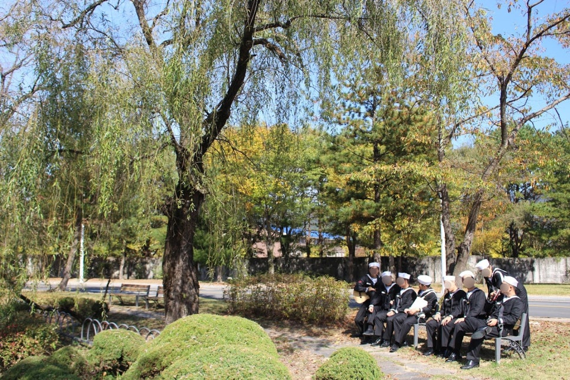

해군 SW개발병을 고민하거나 준비하는 분들을 위해, 선후임들의 블로그 글을 모았다. 같은 보직이라도 기수·시기·관점에 따라 느낌이 다르니, 여러 글을 함께 읽어보시길 추천한다.

## 합격 수기

- [해군 SW개발병 합격 수기 — 1전 2기, 두 번 만에 붙다](/blog/navy-sw-developer-acceptance/) — @우주최강개발자 (2022 입대)
- [해군 SW개발병 합격 수기](https://blog.hothyun.com/posts/%ED%95%B4%EA%B5%B0-SW%EA%B0%9C%EB%B0%9C%EB%B3%91-%ED%95%A9%EA%B2%A9-%EC%88%98%EA%B8%B0/) — @HotHyun (2025 입대)
- [해군 SW 개발병 합격 수기 24-10](https://ps.mjstudio.net/daily-241122-navy-sw-1) — @MJ Studio (2025 입대)
- [해군 SW개발병 합격 수기](https://www.sigee.xyz/posts/02-navyintro/) — @MINSEOK CHOI (2025 입대)

## 복무 후기

- [해군 SW 개발병 복무 후기](https://pacokwon.org/posts/after-navy-software-developer/) — @Paco Kwon (2021 입대)
- [해군병 682기 SW 개발병 복무 후기](https://enkoding.dev/posts/naval-sw-developer) — @enKODING (2022 입대)
- [Goodbye and Hello World (전역)](https://devkly.com/essay/goodbye-and-hello-world-again/) — @Juna (2022 입대)
- [해군 SW 개발병 복무 일지 (1)](https://blog.hothyun.com/posts/%ED%95%B4%EA%B5%B0-SW-%EA%B0%9C%EB%B0%9C%EB%B3%91-%EB%B3%B5%EB%AC%B4-%EC%9D%BC%EC%A7%80-1/) — @HotHyun (2025 입대)
- [해군 SW개발병으로 살아남기](https://www.sigee.xyz/posts/01-navysurvive/) — @MINSEOK CHOI (2025 입대)

## 복무 중 특별한 경험

- [해군 수병이 공군 헬기로 떠난 울릉도·독도 2박 3일](/blog/ulleungdo-dokdo-trip/) — @우주최강개발자 (2022 입대)

