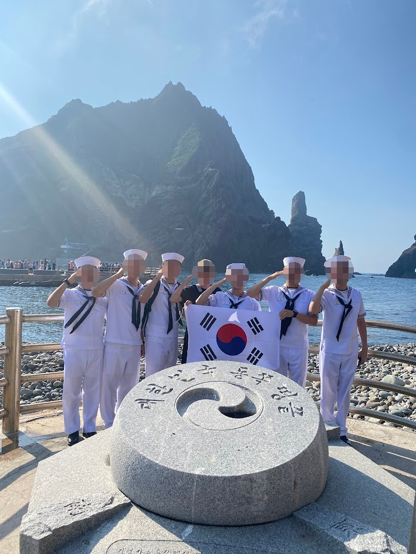
*마침내 독도에 닿다.*

> 해군 병사가 공군 헬기를 타고 울릉도로 떠났다.

군 입대 전부터 막연히 해보고 싶었던 게 있었다. **군용 헬기를 타보는 것.** 인터넷에서 일반 병사도 신청하면 군용기를 탈 수 있다는 글을 본 뒤로 군대에 가면 꼭 해봐야겠다고 생각했다.

방법은 **공군 정기공수**를 이용하는 것이다.

## 사무실에서 노선을 찾아본 그날

군 입대 후 사무실에서 문득 생각이 났다. 바로 인트라넷으로 정기공수 노선을 확인해봤다. 단순히 헬기를 체험 목적으로 타고 내리는 것보다는, 노선을 따라가서 그 지역을 여행하고 싶었다.

노선을 살펴보니 가장 흥미로운 지역이 **제주도와 울릉도**였다. 그중에서도 울릉도가 압도적이었다. 제주도는 민항기로 많이 가봤지만, 울릉도는 가본 적도 없었고, 공항 건설은 진행 중이지만 당장은 여객선으로만 갈 수 있는 곳이다. 그런 울릉도를 **헬기를 타고** 간다는 상상만으로 도파민이 터졌다.

이 계획을 선후임들에게 꼬셔서 결국 **7명이 함께** 울릉도로 떠나기로 했다.

## 정기공수란?

정기공수는 공군이 물자·인원 수송을 위해 운용하는 **정기 노선 군용기**다. 빈 자리가 있을 때 미리 신청하면 군인은 무료로 탑승할 수 있다.

- **신청**: [국방수송정보체계 (DTIS)](https://www.dtis.mil.kr/)
- **이용 대상**: 국군 장병·군무원·사관생도, 직업군인 가족 등
- **비용**: 무료

다만 한 가지 주의할 점이 있다. **탑승 신청은 인터넷·인트라넷 모두에서 가능하지만, 계정 생성은 군 인트라넷에서만 가능하다.** 그래서 처음 이용하려면 인트라넷에서 미리 계정을 만들어야 한다.

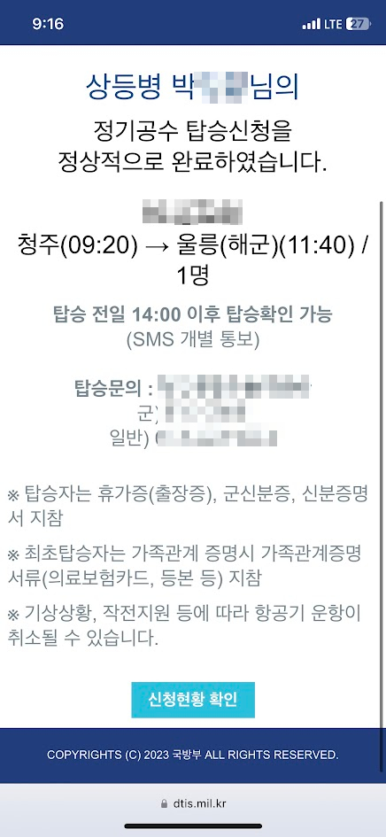
*DTIS에서 정기공수 탑승 신청을 완료하면 위와 같은 확인 화면이 표시된다. 노선·시간·지참 서류 안내가 함께 표시된다.*

또 까다로운 점이 있다. **탑승 확정 여부가 전날 나온다.** 날씨가 안 좋거나 공무 인원·물자가 우선이라 자리가 없으면 탈 수 없다. 게다가 당일에도 날씨로 취소될 수 있다.

> 💡 정기공수에 대한 더 자세한 설명은 [병무청 공식 안내 글](https://blog.naver.com/mma9090/223025122467)을 참고하면 좋다.

## 헬기와 배, 차량을 모두 묶은 일정

우리는 **독도까지 가는 게 목표**였기 때문에, 독도 입항 확률이 높은 날씨 좋은 **6월**로 일정을 정했다.

노선상 청주에서 출발해 울릉도에 도착하는 헬기 편이라, 계룡대에서 청주공항까지 **공항택시를 미리 예약**해 이용했다. 청주공항은 민군 겸용공항이지만, 정기공수는 민항기처럼 체크인하는 방식이 아니다. **전날 안내를 통해 집결지를 별도로 안내받는다.** 도착지(울릉도 군기지) 위치는 군사기밀이라 시스템에 표시되지 않아, 인트라넷의 연락처로 직접 전화해서 안내받았다.

날씨가 안 좋아 독도 입항이 안 될 가능성을 대비해 **1일차와 2일차 모두 여객선을 예약**해두었다. 정기공수 자체가 전날 취소되면 어떻게 할지는 따로 대비하지 않았다 (사실상 그 시점에는 어쩔 방법이 없었다).

나는 평소 여행에서 숙소·교통 정도만 미리 예약하는 파워 P지만, 이번엔 헬기·여객선·차량 렌트·기차·공항택시 등 교통 수단이 너무 많아서 J처럼 직접 계획하고 조율해야 했다.

## 1일차, 청주에서 헬기로 울릉도와 독도까지

새벽부터 움직였다. **휴가 출타보고를 마치자마자 부대 정문 앞에 대기 중이던 공항택시에 올라 청주공항으로 향했다.** 안내받은 집결지에 도착해 대기했다.

청주에서 우리를 기다리던 건 **CH-47 치누크** 헬기였다. 영화 *월드워Z*에서 보던 그 거대한 후방 램프 헬기다. 꼬리 쪽으로 탑승하는 구조인데, 문이 닫혀도 위쪽이 뚫려 있다.

헬기는 처음 타봐서 설렜다. 솔직히 민간 비행기와 비슷할 줄 알았는데, **소음이 굉장히 심했다**. 이어플러그를 나눠주고 헤드셋처럼 생긴 귀마개도 함께 쓰는데, 그래도 소음이 컸다.

그런데도 그 불편한 자리, 그 소음 속에서 **잤다.** 사실 나는 미국행 13시간 비행 이코노미에서도, 낯선 잠자리에서도 곧잘 자는 편이긴 하다. 인간의 적응력은 대단하다.

중간에 **포항** 등 다른 비행장을 거쳐갔다. 거기서 잠깐 내려 다른 헬기·항공기들을 구경할 수 있었다. 이 경험을 사진으로 남길 수 없었던 건 아쉽다. 군사기지·장비라 사진 촬영이 금지되어 있고, 보안상·규정상 당연한 부분이라는 건 이해한다.

다행히 우리가 탔던 것과 같은 기종의 CH-47 치누크 헬기 사진은 국방일보에서 확인할 수 있다.

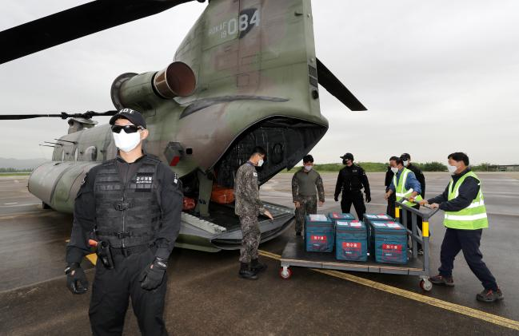
*CH-47 치누크 헬기 외관. (사진: 국방일보)*

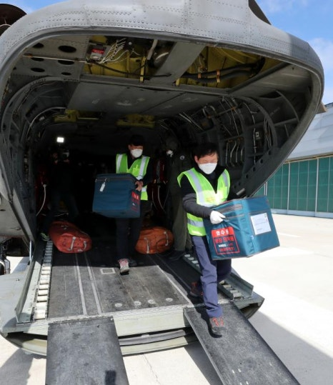
*꼬리 쪽으로 열리는 후방 램프 구조. 우리가 탑승한 입구이기도 하다. (사진: 국방일보)*

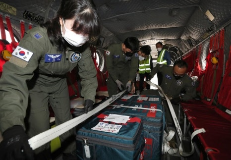
*헬기 내부 모습. 우리도 이와 비슷한 자리에 앉아 비행했다. (사진: 국방일보)*

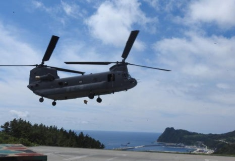
*울릉도 해군 기지 헬기장에 착륙하는 CH-47 치누크. (2021.7.23 코로나19 백신 수송 당시 / 사진: 국방일보)*

> **참고로**, 민간 헬기로 영덕에서 울릉도까지 가려면 왕복 약 **780만원**(10인 기준, 인당 약 78만원)이 든다. 예능 *지구마불 세계여행*에서 곽튜브가 우승 상품으로 헬기를 타고 울릉도에 간 사례가 화제였던 이유다. 우리가 탄 CH-47 치누크는 민간에서 빌릴 수조차 없는 기종인데, **정기공수 덕분에 7명의 선후임들과 함께 무료로 타본 셈이다.**

사실 울릉도에는 **해군 기지와 공군 기지가 각각 따로 있다**. 시내에서 더 가까운 곳은 해군 기지여서 원래 우리는 그곳에 내릴 예정이었지만, 그날 기상 이슈로 해군 기지 착륙이 불가해 **공군 기지에 내려야 했다.** 그래서 시내까지의 이동 거리가 예상보다 좀 길어졌다.

헬기에서 내려 택시를 불러 시내로 향했다. 가는 길에 친절하신 택시기사님께서 울릉도에 대한 이런저런 안내를 해주셨다. 차창 밖으로는 바다 위로 솟아오른 거대한 기암괴석들이 스쳐 지나갔다. 풍경 하나하나가 낯설고 신기했다.

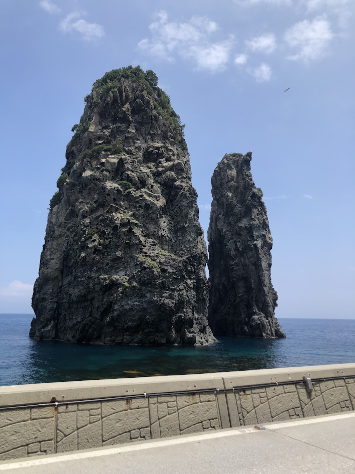
*시내로 향하는 길, 차창 밖으로 마주한 울릉도의 기암괴석.*

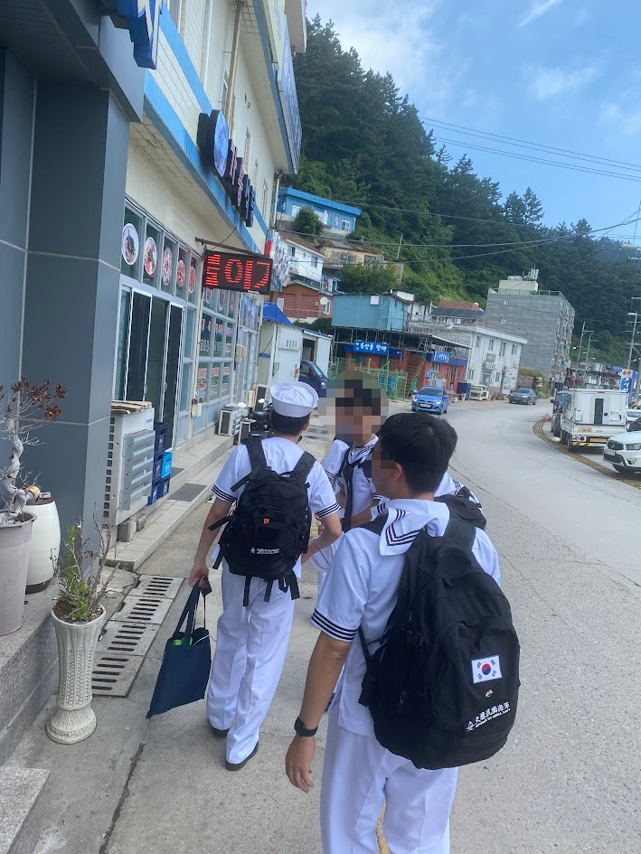
*정복 차림으로 울릉도 시내에 첫발을 디뎠다.*

저동항에 도착해 근처 **가송식당**에서 **따개비밥**으로 점심을 먹었다. 짭조름한 따개비와 들기름 향이 잘 어우러진, 향토 음식다운 맛이었다.

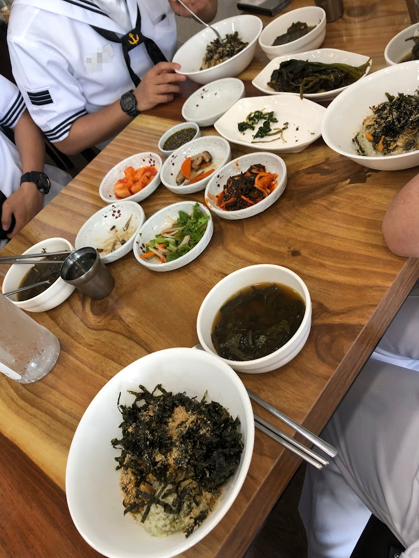
*가송식당의 따개비밥. 울릉도에서 맛본 첫 향토 음식.*

점심을 마치고 정복 차림 그대로 저동항 여객선 터미널로 향했다.

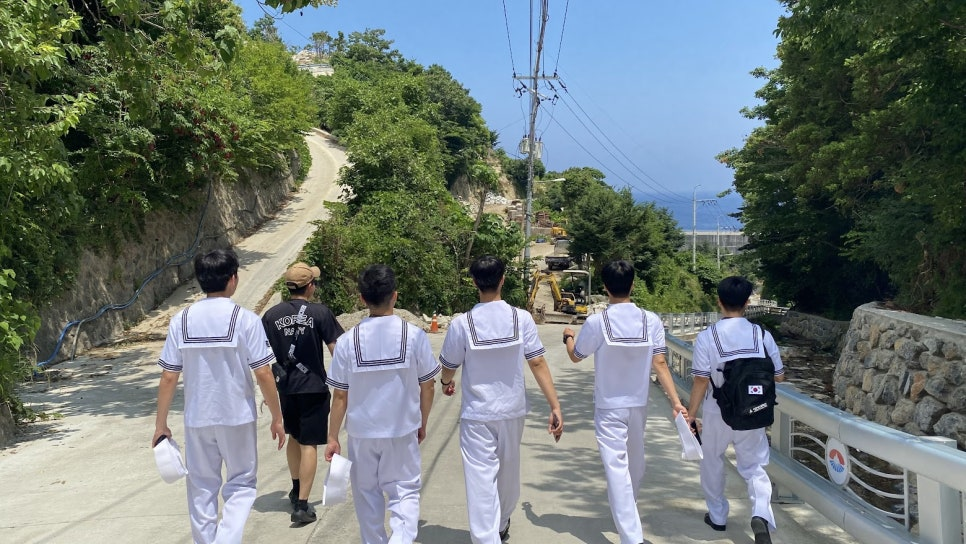
*점심을 마치고 저동항으로 향하는 길.*

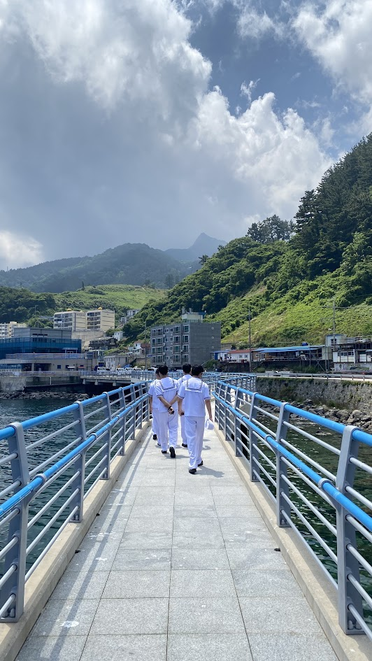
*뒷모습마저 그림 같던 정복 차림 일행.*

부두에 도착해 엘도라도호 승선권을 받고 출항을 기다렸다. 부두 난간 위로 갈매기들이 한가롭게 앉아 있었다.

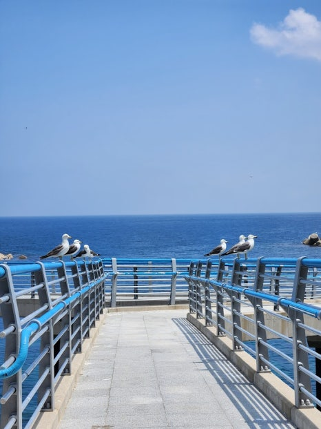
*부두 난간에 앉아 있던 갈매기들.*

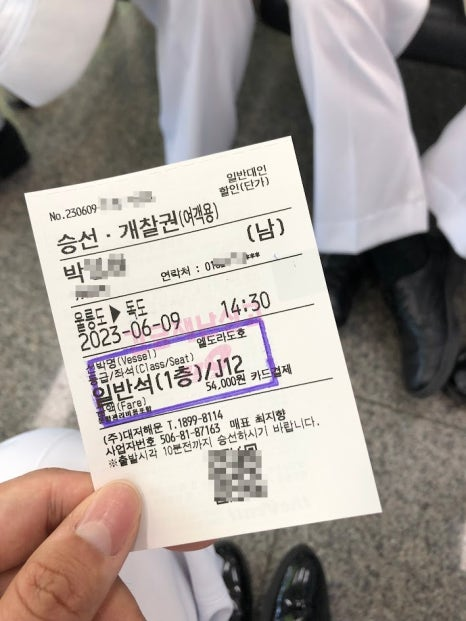
*엘도라도호 승선권. 군인 할인이 적용된 가격이었다.*

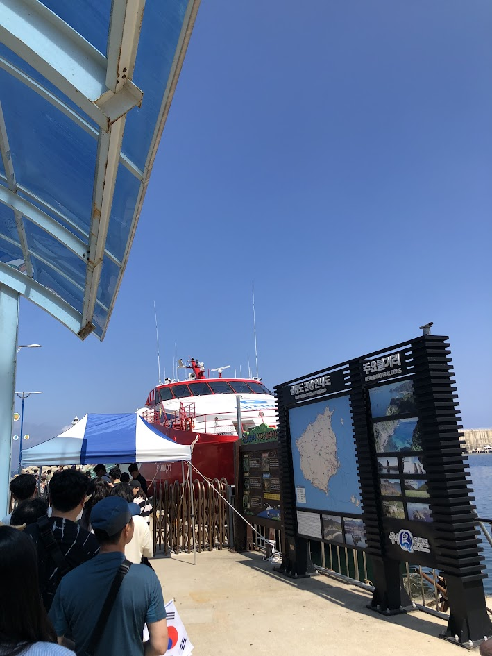
*우리를 독도까지 데려다 줄 엘도라도호.*

엘도라도호가 약 한 시간 반을 항해해 독도로 향했다. 다행히 날씨가 좋아 **1일차에 바로 독도 입항**이 가능했다.

멀리서 독도가 시야에 들어왔다. 사진으로만 보던 그 모습이 정말로 눈앞에 있었다. 가까워질수록 마음이 묘하게 들떴다.

배에서 내려 처음 발을 디딘 순간, 어딘가 비현실적이었다. 평생 한 번 가볼까 말까 한 곳을, 그것도 정복 차림으로 서 있는 셈이다. **해군 정복을 입고 있던 탓에 주변 관광객들의 이목도 많이 받았다.**

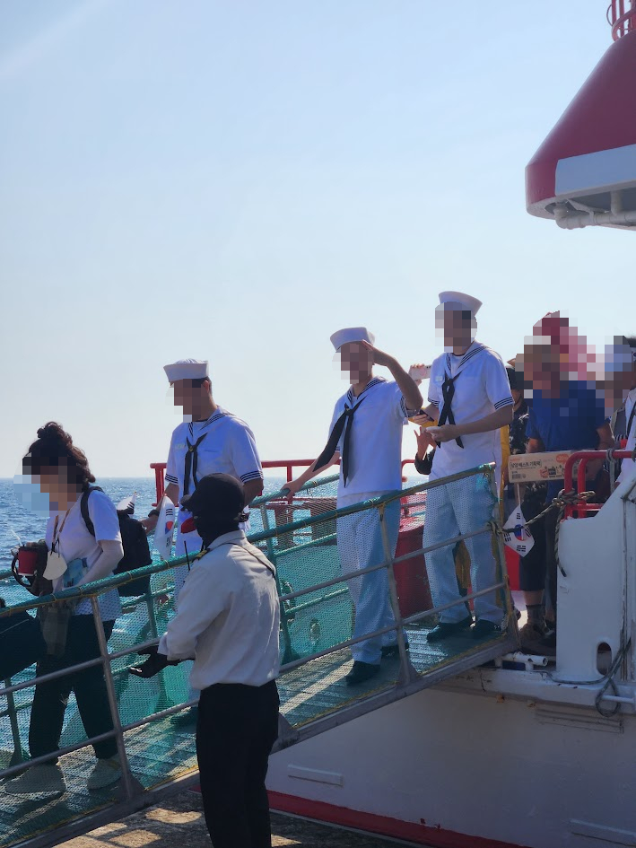
*독도에 첫발을 디딘 순간. 평생 잊지 못할 장면이다.*

독도에서는 약 **30분의 시간**이 주어진다. 그 짧은 시간 동안 우리는 부두 끝까지 걸어가 보고, 표지석 앞에서 사진을 남기고, 단체 사진도 찍었다.

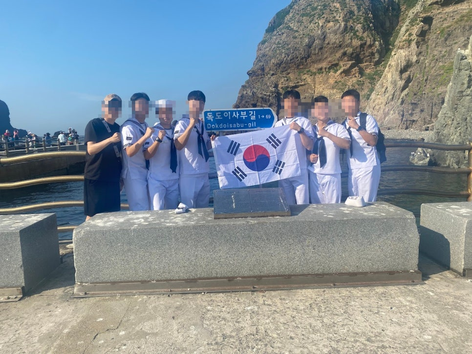
*독도이사부길 표지판 앞에서.*

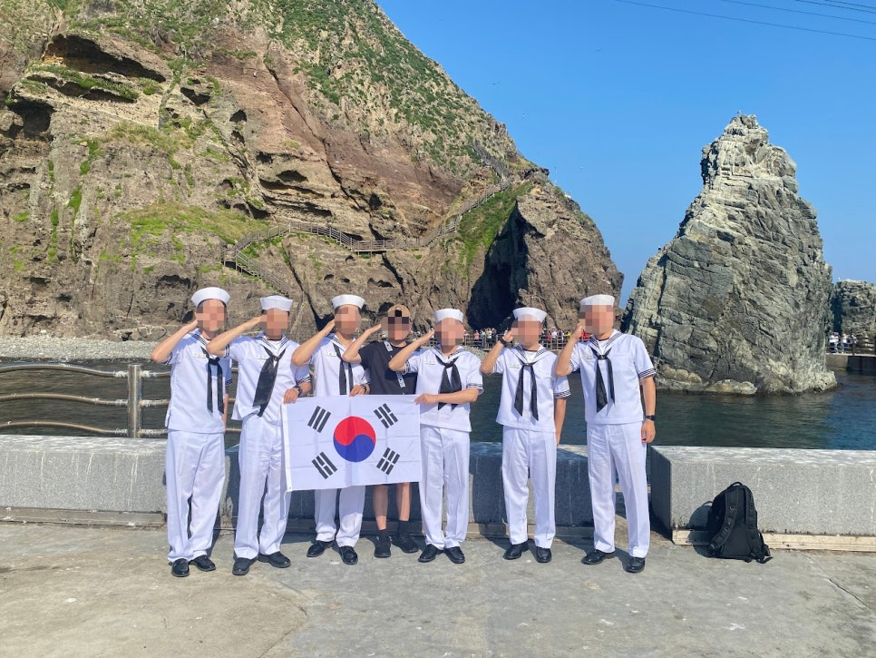
*독도를 배경으로 7명이 함께 경례.*

30분은 의외로 빨리 흘렀다. 다시 배에 오르며 **"언제 또 와볼 수 있을까"** 라는 생각이 들었다. 멀어지는 독도를 한참 바라봤다.

새삼 든 생각도 있었다. **여권 없이 입도했고, 도로명 표지판마저 한국 본토에서 보던 것과 동일한 형태로 한국어로 쓰여 있었다.** 일본이 끊임없이 분쟁 지역으로 만들려 하지만, 직접 그곳에 발을 디뎌본 사람이라면 의심의 여지가 없다. **독도는 명백한 우리 땅이다.**

참고로 독도를 다녀온 사람은 **울릉군 독도명예주민증**을 신청해 받을 수 있다. 나도 다녀온 뒤에 신청해서 받았다. 평생 간직할 작은 기념품 같은 것이다.

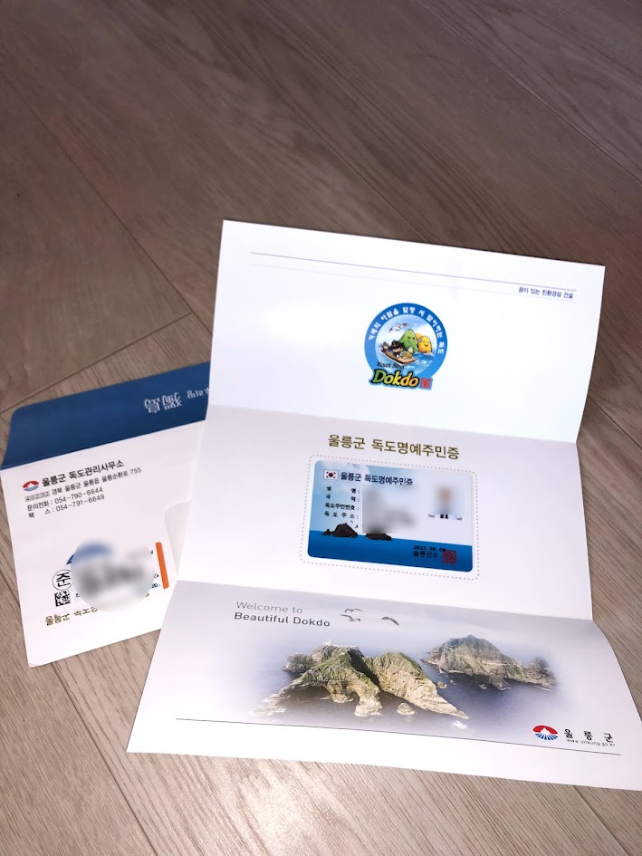
*독도를 다녀온 뒤 신청해서 받은 울릉군 독도명예주민증.*

저녁은 **울릉오징어회타운**에서 회와 독도새우를 사 와서 숙소에서 먹었다. 수산시장처럼 회를 사 갈 수 있는 곳이었는데, 듣던 대로 **독도새우는 비싸서 많이는 못 먹었고, 회를 위주로 푸짐하게 즐겼다.**

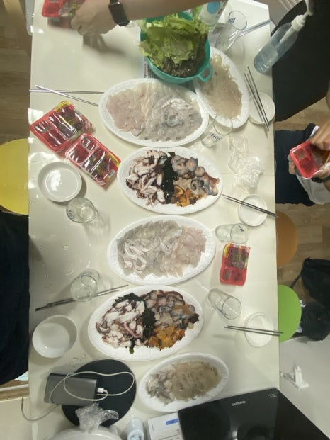

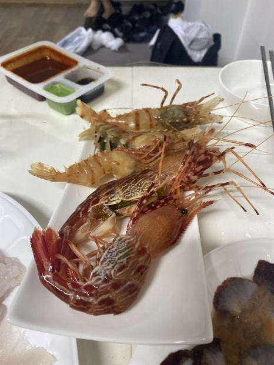

*1일차 저녁*

## 2일차, 스쿠터로 울릉도 한 바퀴

2일차는 미리 예약해둔 차량과 **스쿠터**를 렌트해서 울릉도 곳곳을 관광했다.

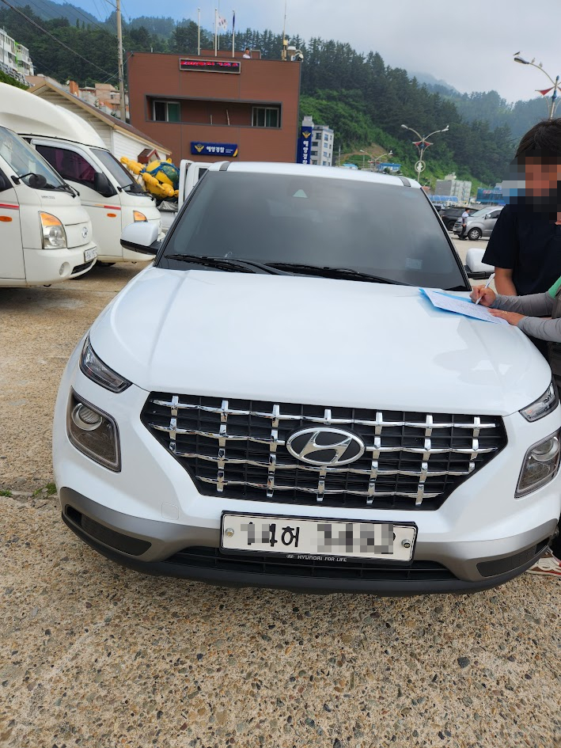
*2일차 일정을 책임진 렌터카.*

스쿠터는 사실 처음 타봤다. 자전거, 승용차부터 수동 스틱 화물차까지 운전해본 경험이 있어서인지 **바로 적응하는 데 어려움이 없었다.** 시원한 바닷바람을 맞으며 탁 트인 시야로 해안도로를 따라 한 바퀴 도는 건 정말 좋았다.

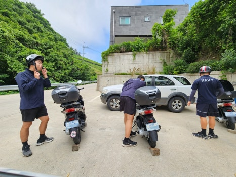
*처음 타본 스쿠터지만 적응은 빨랐다.*

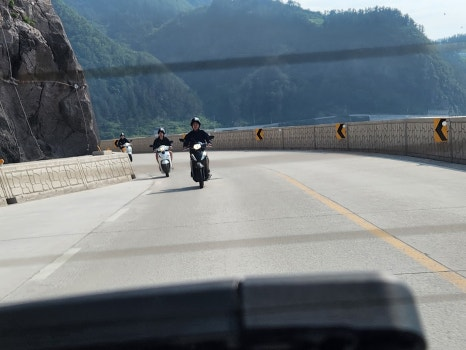
*해안도로를 따라 달리는 스쿠터 일행.*

먼저 들른 곳은 도동에 있는 **독도박물관**이었다. 사실 해군에는 **전사적지를 방문하면 휴가를 추가로 부여**하는 제도가 있는데, 독도박물관도 그 대상에 포함된다. 단순한 관광을 넘어, 군 복무 중에 역사적인 장소를 자연스럽게 찾아보는 계기가 되어주는 좋은 제도라고 느꼈다.

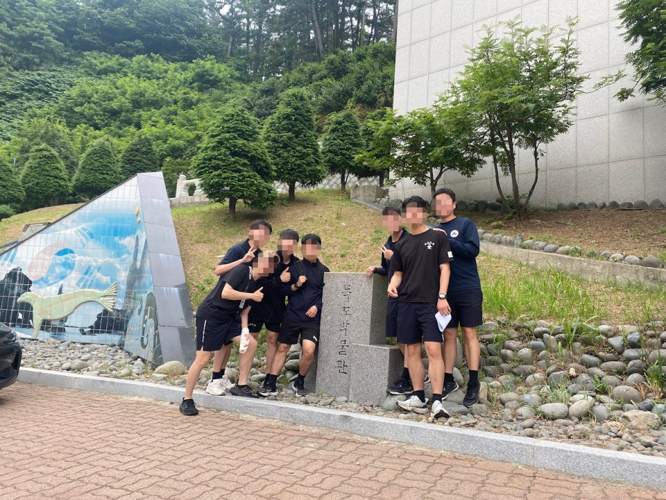
*독도박물관 앞에서. 전사적지 휴가 덕분에 더 의미 있는 방문이었다.*

### 그런데 한 가지 사건이 있었다

박물관을 둘러본 뒤 **태양식당**에서 **따개비죽**으로 점심을 먹었다. 맛이 정말 좋았다.

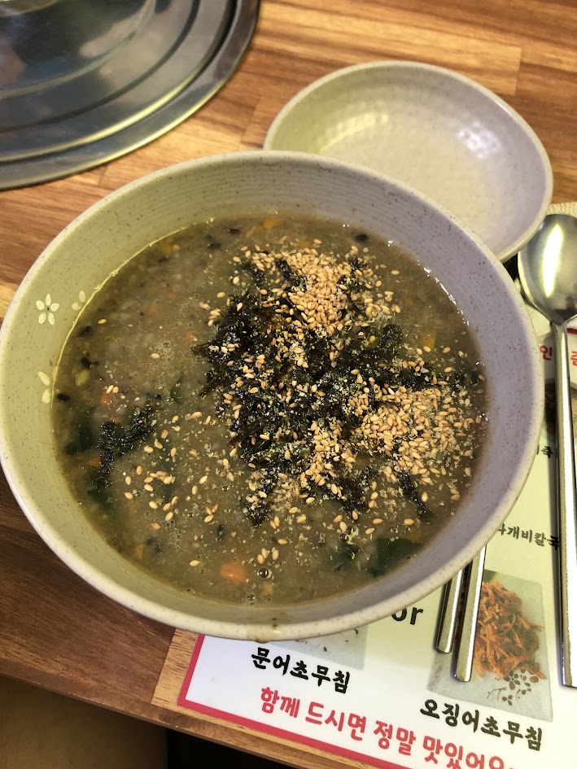
*태양식당의 따개비죽. 따개비밥과는 또 다른 풍미.*

그런데 식당에는 공군과 해군 간부들이 각각 식사 중이었다. 우리는 부대에서 바로 휴가를 나온 터라 사복 없이 **해군 체육복** 차림이었다.

식사를 마치고 우리가 스쿠터와 차량을 타려고 하자, 한 해군 간부가 다가왔다. **"병사는 운전 못하는 거 아냐?"** 라는 것이었다. 우리는 사전에 규정을 확인했고, 병사 운전을 금지한다는 규정이 없다고 말씀드렸다.

그러자 **"대드는 거냐"**, **"너희 부대 간부 연락처 불러라, 연락하겠다"** 라는 식으로 나오시는 것이었다. 다른 간부분이 말려주셔서 그 자리는 마무리됐다.

실제로 나는 차량 렌트하면서 관련 규정을 직접 찾아봤었고, 사무실 간부님들께도 휴가 계획을 말씀드리면서 운전 사실을 알렸을 때 별말씀이 없으셨다. 이 사안에 대해 공식 민원을 제기하려고도 했고, 해당 간부의 신원까지 확인했지만, **격오지에서 복무하는 분이기도 하고, 우리도 기분 상한 것 외에는 큰 불이익이 없었기에** 민원까지는 가지 않았다.

다만 이 일화 이후 든 생각이 있다. **함정 근무나 도서·격오지 부대에 아직 부조리가 남아있다**는 이야기를 훈련소 동기들을 통해 듣곤 했었는데, 단순한 병사 간 부조리뿐 아니라 이런 간부의 태도를 직접 보니 그런 곳에서 복무하는 것이 정말 쉽지 않겠다는 생각이 들었다.

> 참고로 군 내 부조리는 **1303 국방헬프콜**, **국민신문고**, **해군인권센터** 등에 신고할 수 있다.

다행히 그 사건이 하루를 망치지는 않았다.

오후에는 **태하 대풍감** 모노레일을 타러 갔다. 모노레일이 내려준 곳이 끝이 아니라 거기서부터 또 한참을 걸어 올라가야 정상이었다. 헉헉대며 오른 보람이 있게, 정상에서 내려다본 풍경은 정말 멋졌다. 발 아래로는 깎아지른 절벽, 그 너머로는 끝없는 동해 바다. 평지에서 보던 울릉도와는 완전히 다른 차원의 풍경이었다.

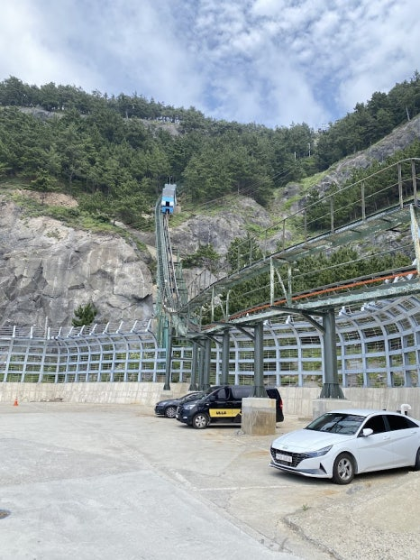
*가파른 절벽을 오르는 대풍감 모노레일.*

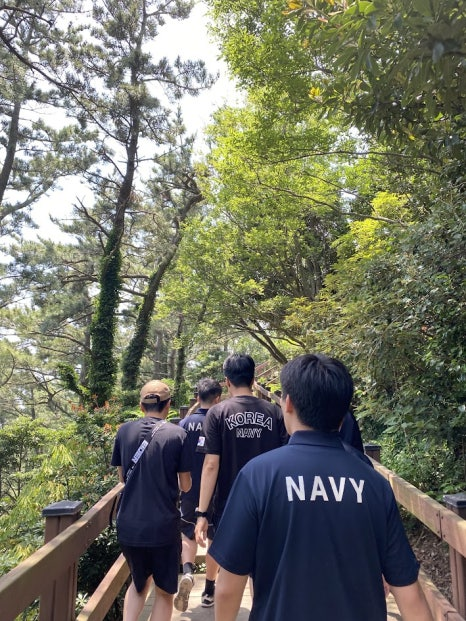
*모노레일에서 내려 정상까지 이어진 산길.*

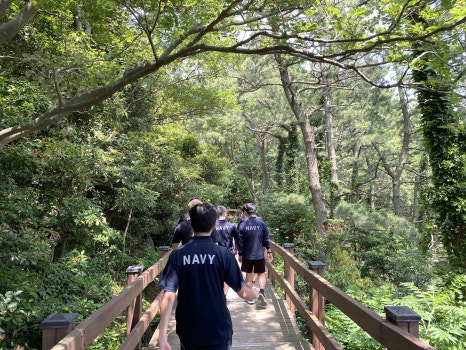
*숲길을 따라 정상으로 향하는 일행.*

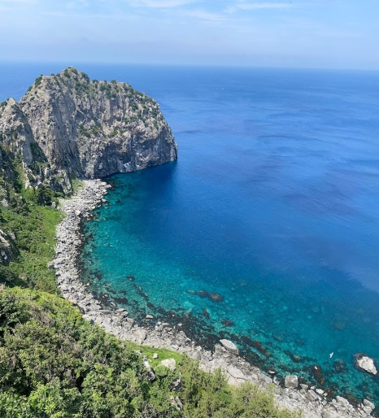
*대풍감 정상에서 내려다본 풍경. 헉헉대며 오른 보람이 있었다.*

돌아오는 길에는 즉흥적으로 바다에 들어가 물놀이까지 즐겼다. **시원한 바닷물에 몸을 담그니 점심의 불쾌한 기억까지 함께 씻겨 내려가는 듯했다.**

저녁은 숙소에서 바베큐를 해 먹었다. 숙소에서 바베큐 장비를 대여해주고, 울릉도 농협 하나로마트에서 장을 봐 와서 직접 구웠다. 장비가 좋아서인지, 고기를 굽는 선임이 워낙 잘 구워서인지, 좋은 사람들과 함께여서인지, 아니면 **셋 다인지** 정말 맛있게 먹었다.

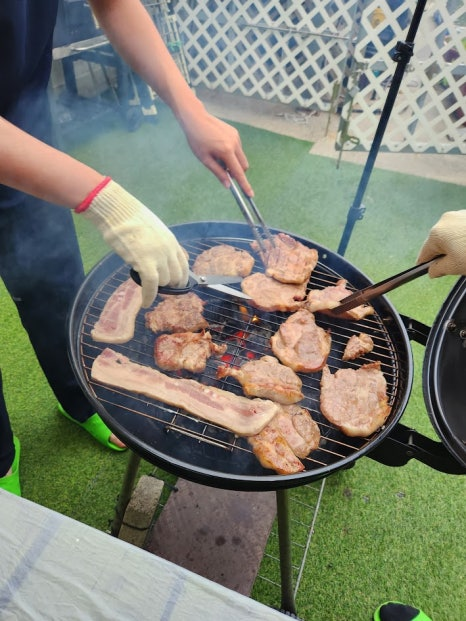
*불에 잘 익어가던 고기들.*

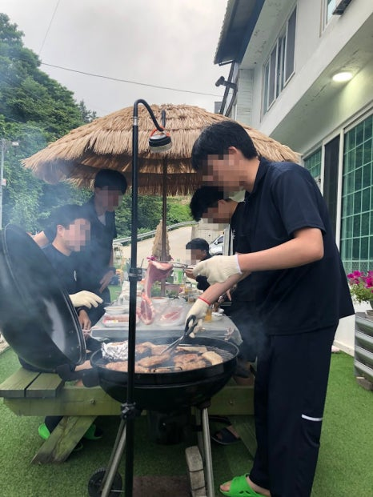
*야자 우산 아래 바베큐를 굽는 분주한 손길.*

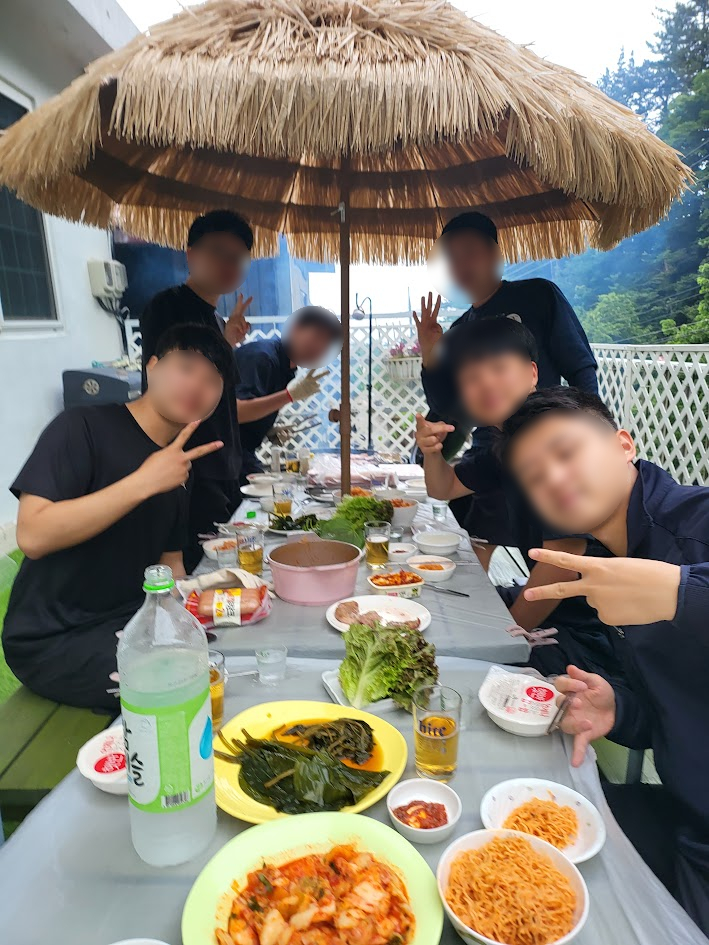
*숙소 바베큐로 마무리한 둘째 날.*

## 3일차, 강릉에서 서울 거쳐 부대로 복귀

울릉도에서 본토로 돌아올 때는 **강릉행 여객선**을 탔다. 가장 빠른 길은 포항이지만, 포항행 배편이 부대 복귀 일정과 맞지 않아 멀더라도 강릉을 통해, 서울을 거쳐 복귀하기로 했다.

여객선을 타기 전, 몇몇 선후임 수병들이 **멀미약을 챙겨 먹는 모습**을 봤다. 고작 몇 시간 타는 배인데도 멀미가 걱정되어서였다. 나는 먹지 않았다. 내가 정말로 배멀미를 하는지 직접 알고 싶기도 했고, 무엇보다 **해군이 배멀미약을 먹는다는 게 어딘가 아이러니하게** 느껴져서였다.

그러다 문득, **매일 군함 위에서 복무하는 전우들**이 떠올랐다. 우리가 몇 시간을 걱정하는 그 흔들림을, 그분들은 일상으로 감내하고 있을 것이다. 훈련소 동기들 말로는 일주일 정도면 멀미에도 적응이 된다고 하지만, 그 일주일조차 결코 가볍지는 않을 것이다.

여객선 안에서 후발대 후임들 팀은 해군 정복을 보고 승무원분들께서 선장실을 구경시켜주셨다고 한다. 우리 팀도 선장실까지는 가지 않았지만, 정복을 입고 있으니 승무원분들께서 어디서 복무하느냐고 종종 물어보셨다.

강릉에 도착한 뒤 KTX로 서울에 올라왔다. 부대 복귀까지 시간이 좀 남아 한강을 들렀다. 먼저 **따릉이**를 빌려 한강 자전거 도로를 따라 라이딩을 즐겼다. 시원한 바람과 함께 **2박 3일이 끝나간다는 것**을 실감했다.

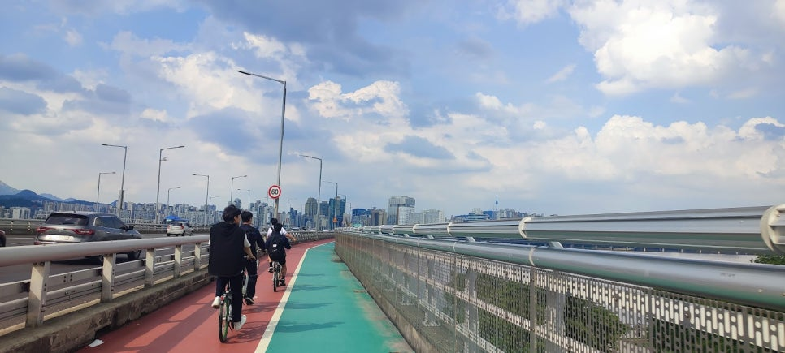
*한강 자전거 도로를 따라 즐긴 따릉이 라이딩.*

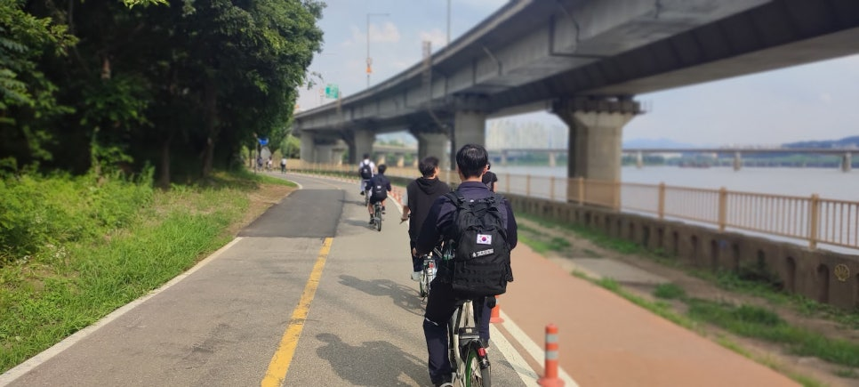
*다리 아래를 지나며 이어진 자전거 라이딩.*

자전거를 반납한 뒤에는 **한강공원에서 치맥과 함께 피크닉**을 즐겼다. 잔디 위에 자리를 잡고 시원한 캔맥주와 치킨·떡을 펼쳤다.

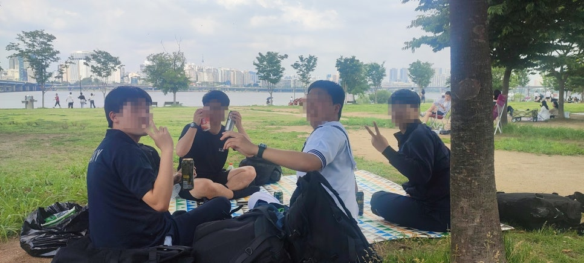
*잔디 위에 자리 잡고 시작한 치맥 피크닉.*

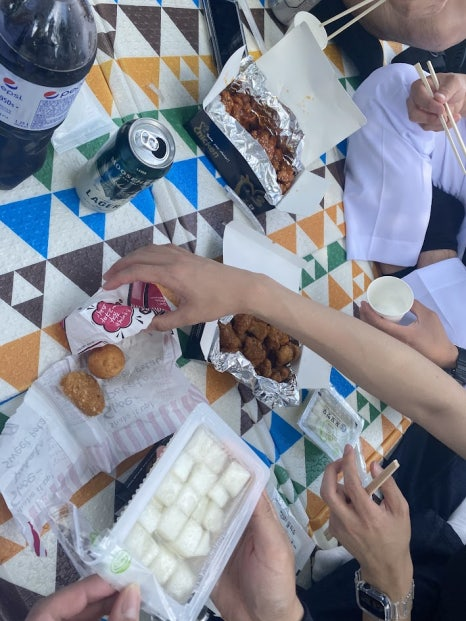
*치킨과 떡, 그리고 캔맥주.*

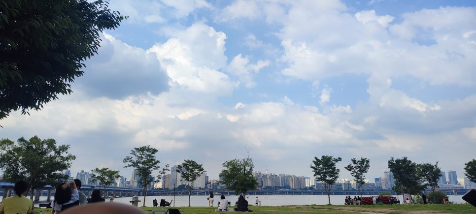
*멀리 남산타워가 보이는 한강 풍경.*

피크닉을 마친 뒤 용산역으로 이동했고, KTX를 타고 계룡으로 복귀했다.

## 운 첩첩산중, 두 번의 행운

이 여행에서 운에 좌우되는 부분이 두 가지였다.

1. **정기공수 탑승 여부** (전날 결정, 날씨·공수편 상황에 따라 취소 가능)
2. **독도 입항 여부** (당일 날씨에 따라 결정)

우리는 두 가지 모두 운이 따랐다.

실제로 우리 이후 해군 SW개발병 사이에서 이 코스가 일종의 **전통**이 되어 두 번의 후속 시도가 있었다고 한다. 한 번은 정기공수가 전날 취소되어 급하게 **부산 여행**으로 변경했다고 들었고, 또 한 번은 우리처럼 정기공수와 독도 입항 모두 **성공**했다고 한다.

사실 우리 부대에도 비상활주로가 있어 군 문화축제 때 헬기 탑승 체험 추첨이 진행되는데, 나는 한 번 신청했다가 떨어진 적도 있었다. 그랬던 내가 결국 정기공수로 헬기를 타볼 수 있었으니, **운이 다른 방향으로 따라준** 셈이다.

참고로 내 인스타 닉네임이 `lucky_seop`이다. 나는 늘 운이 따른다고 믿는 편인데, 이번 여행에서도 그 믿음이 또 한 번 증명된 셈이다.

## 전체 일정 정리

**1일차**
- 부대 휴가 출타 → 정문 앞 공항택시
- 계룡 → 청주공항
- 청주 → 울릉도 공군 기지 (공군 정기공수 CH-47 치누크)
- 점심: 가송식당 따개비밥
- 오후: 저동항 → 엘도라도호 → 독도 입항
- 저녁: 울릉오징어회타운 회·독도새우 (숙소에서)

**2일차**
- 차량·스쿠터 렌트
- 도동 독도박물관 (전사적지 휴가 대상)
- 점심: 태양식당 따개비죽
- 오후: 태하 대풍감 모노레일·산행 → 바다 물놀이
- 저녁: 숙소 바베큐

**3일차**
- 오전: 울릉도 → 강릉 여객선
- 강릉 → 서울 KTX
- 한강 따릉이 라이딩
- 한강공원 치맥 피크닉
- 용산 → 계룡 KTX 부대 복귀

## 마무리

2박 3일이라는 길지 않은 일정이었지만, 다양한 교통수단과 풍경, 그리고 선후임들과 함께한 시간이 합쳐져 **군 생활 중 가장 인상 깊은 휴가**로 남았다.

혹시 지금 군 복무 중이라면, 정기공수를 꼭 한 번 경험해보길 권하고 싶다. 민간에서는 누릴 수 없는, **군인이기에 누릴 수 있는 특권**이다. 나라를 지키는 그 시간 속에서, 이런 특별한 경험 하나쯤 만들어보는 것도 분명 의미가 있다.

휴가 목적으로 헬기를 이용했던 우리와 달리, 같은 헬기로 작전하는 전우들, 그리고 **군함에서 묵묵히 복무하는 동기·선후임들**을 비롯해 보이지 않는 곳곳에서 복무 중인 모든 분들의 노고에 새삼 감사한 마음이 든다.

**Thank You for Your Service.**
**나라를 위해 헌신해주셔서 감사합니다.**
